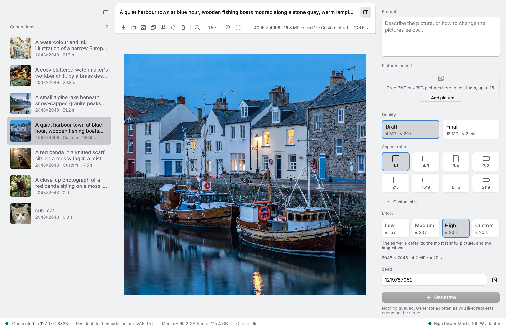
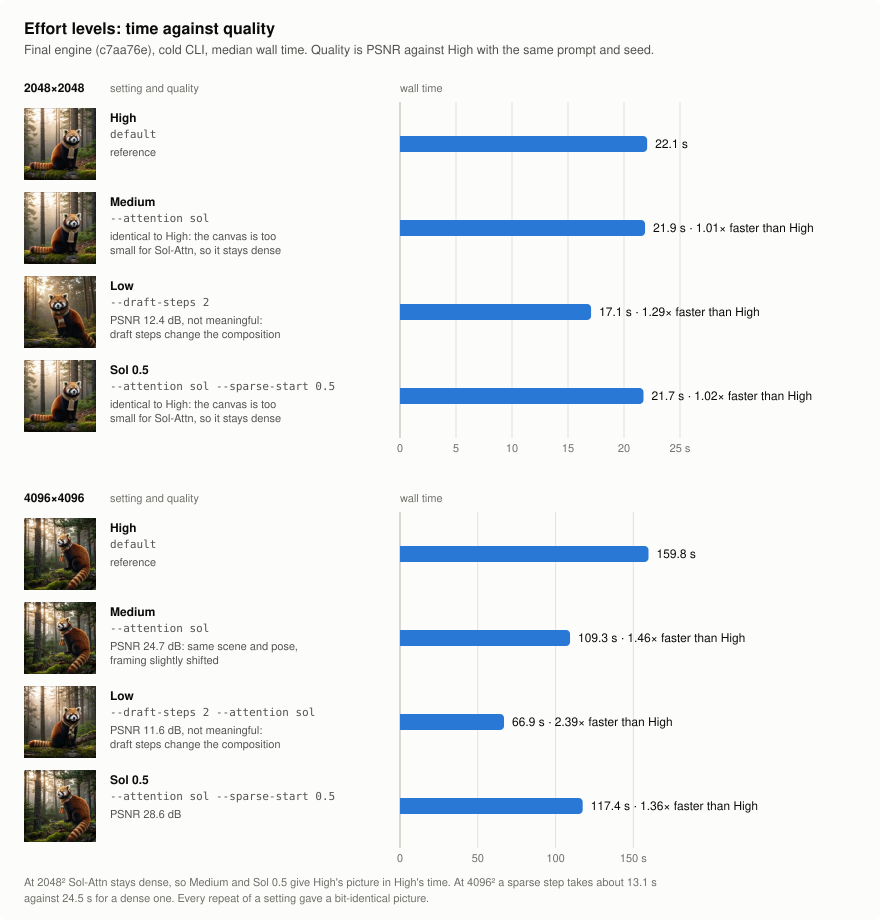

# mmh3 studio

A native and web studio for generating pictures with
[MiniMax-H3-Image](https://huggingface.co/MiniMaxAI/MiniMax-H3-Image) on a Mac, through a resident
[mmh3](https://github.com/niw/mmh3) server.

<picture>
  <source media="(prefers-color-scheme: dark)" srcset="docs/screenshots/studio-dark.webp">
  
</picture>

<p>
  
  
  
  
</p>

Pictures from the studio at 2048×2048 and Effort High, 19–22 s each on a MacBook Pro M5 Max.

## What it is

`mmh3 server` keeps the text encoder, DiT and VAE loaded between generations, so a picture never
pays a cold start. The studio is its client: it asks for pictures, follows them as they run and
keeps the ones you made. It never loads a model itself.

- **Native:** a macOS app built with [Rune](https://github.com/anomalyco/rune), drawn on the GPU.
- **Web:** the same app in a browser through Rune's WebGPU target. The server listens only on
  loopback and has no authentication, so to use the studio from a phone or another computer, put
  it on your tailnet with [Tailscale Serve](https://tailscale.com/kb/1312/serve).

## Features

- **Previews and Stop:** a preview after each of the six steps, in the picture pane and the
  gallery, and a Stop button that ends a generation within one step.
- **Live updates:** every generation arrives through `GET /v1/events` as it happens. Against a
  server without that route, the studio reads the list every two seconds instead.
- **History:** the gallery lists every picture on the server, newest first, with its prompt, size,
  seed, effort and time. The server keeps each generation in a directory of its own, holding
  `image.png`, `metadata.json` (the request, the timings, the models and the machine) and
  `previews/`, and lists them again after a restart.
- **Actions:** save the PNG, reveal it in Finder, copy the prompt or the seed, re-run with a new
  seed, edit the picture, or delete it. Click the time to see where it went, stage by stage.
- **Size:** a quality, Draft (about 4 MP) or Final (about 16 MP), times an aspect ratio from 21:9
  to 9:16, or a custom size. Each choice shows how long it should take, fitted to the latest
  generations on this machine.
- **Effort:** High leaves the server's defaults for the most faithful picture. Medium runs Sol-Attn
  sparse attention from the third step, which can rewrite small lettering and only helps on a
  canvas of about 12.6 MP or more. Low adds two draft steps at half size, which change the
  composition. Custom sets each option on its own.
- **Edits:** drop up to 16 PNG or JPEG pictures on the composer and refer to them in the prompt as
  `<Picture 1>`, `<Picture 2>` and so on, or edit a finished picture.
- **Power banner:** says why a picture is slow when the Mac is not in High Power Mode, is on
  battery, is hot, or another process keeps the CPU busy, and copies the `pmset` command that turns
  High Power Mode on. On a 14-inch MacBook Pro with an M5 Max, the case's power and cooling limit
  the GPU whatever the adapter.

The [studio's README](apps/studio/README.md) describes each of these in full, and what changes in a
browser.

## Speed

The engine the flake builds, cold CLI, median seconds per picture:

| Effort | 2048² | 4096² |
| --- | --- | --- |
| High | 22.1 s | 159.8 s |
| Medium | 21.9 s | 109.3 s |
| Low | 17.1 s | 66.9 s |

14-inch MacBook Pro, Apple M5 Max, 128 GB, macOS 27, on AC with the 100 W adapter, in High Power
Mode, with the GPU held at about 0.9–1.0 GHz by the case's thermal limit at 4096².



[Benchmarks](docs/benchmarks/README.md) has the method, the conditions, the pictures each effort
gives, and how the engine compares with the upstream Metal PR.

## Getting started

### Requirements

- An Apple silicon Mac. mmh3 runs the DiT on the GPU's matrix units, the Neural Accelerators of an
  M5 or later, so a picture is fast only on those chips.
- macOS 26 or later, which the engine needs for the matrix units and for edits.
- About 50 GB of disk for the models, and memory to keep them resident: the server holds the text
  encoder, DiT and VAE at once.
- [Nix](https://nixos.org) with flakes, and Xcode, which builds mmh3's Metal and Swift parts.

### Models

The server reads three files from Hugging Face, laid out as ComfyUI does:

| File | Repository | Size |
| --- | --- | --- |
| `text_encoders/qwen3vl_32b_minimax_h3_int8_convrot.safetensors` | [Comfy-Org/MiniMax-H3](https://huggingface.co/Comfy-Org/MiniMax-H3) | 27 GB |
| `diffusion_models/minimax_h3_image_pruned_int8_convrot.safetensors` | [Comfy-Org/MiniMax-H3-Image](https://huggingface.co/Comfy-Org/MiniMax-H3-Image) | 21 GB |
| `vae/minimax_h3_image_vae_fp16.safetensors` | [Comfy-Org/MiniMax-H3-Image](https://huggingface.co/Comfy-Org/MiniMax-H3-Image) | 1.2 GB |

```sh
hf download Comfy-Org/MiniMax-H3 \
  text_encoders/qwen3vl_32b_minimax_h3_int8_convrot.safetensors --local-dir models
hf download Comfy-Org/MiniMax-H3-Image \
  diffusion_models/minimax_h3_image_pruned_int8_convrot.safetensors \
  vae/minimax_h3_image_vae_fp16.safetensors --local-dir models
```

The engine's `tools/download-models.sh --image` fetches the same files, along with the video models.

### Run

The flake builds mmh3 and the studio, so neither needs a checkout. Start the server, which listens
on `127.0.0.1:8833`, then the studio:

```sh
MMH3_MODELS=$PWD/models nix run github:ryoppippi/mmh3-studio#mmh3 -- server
nix run github:ryoppippi/mmh3-studio
```

The first picture loads the models; every later one starts at its first step.

### In a browser

From a checkout, build the web studio and serve it beside the server's `/v1` routes on one origin,
then open http://localhost:8000:

```sh
just studio::web-build
just studio::web-serve       # target/web on 127.0.0.1:8000, /v1 to 127.0.0.1:8833
```

To reach it from your phone, put it on your tailnet's HTTPS name. Don't use `tailscale funnel`: the
server has no authentication.

```sh
tailscale serve --bg --https=443 http://127.0.0.1:8000
tailscale serve status       # prints the https://<machine>.<tailnet>.ts.net/ address
```

## Development

`direnv allow` loads the dev shell (Rust, `just`, the formatters and the pre-commit hooks), and
`just` lists the tasks. The main ones:

| Recipe | What it does |
| --- | --- |
| `just server` | Runs `mmh3 server` with the models in `$MMH3_MODELS`, or in `./models`. |
| `just studio::run` | Runs the studio against the server. |
| `just studio::run-mock` | Runs the studio against a mock server, without the engine or the GPU. |
| `just studio::web-dev` | Rebuilds the web studio on every change. |
| `just studio::test` | Runs the client, mock, state machine and UI tests. |
| `just studio::screenshots` | Renders the UI's scenes headless into `apps/studio/screenshots/`. |
| `just check` | Runs every flake check: formatting, typos, clippy and the tests. |

The repository:

- `apps/studio`: the Rune app, native and web, with the mock server and the web proxy. See its
  [README](apps/studio/README.md).
- `apps/studio-web`: the web build's entry point and page.
- `nix`: the packages (the studio, its web build and mmh3), checks, formatting and the dev shell.
- `docs`: the [benchmarks](docs/benchmarks/README.md) and these screenshots.

The engine is the flake input `github:ryoppippi/mmh3/studio`, a fork of
[niw/mmh3](https://github.com/niw/mmh3) whose `studio` branch adds per-step previews, cancellation,
the events stream and per-job metadata, which are not upstream yet. Against an upstream server the
studio still works, without previews or Stop.

## Licence

This repository is under the [MIT licence](LICENSE).

The model weights are not part of it and come under the
[MiniMax-H3-Image licence](https://huggingface.co/MiniMaxAI/MiniMax-H3-Image/blob/main/LICENSE),
including its territorial restrictions; read it before using them.

The engine is [mmh3](https://github.com/niw/mmh3) by niw, the UI is built with
[Rune](https://github.com/anomalyco/rune), and the model is
[MiniMax-H3-Image](https://huggingface.co/MiniMaxAI/MiniMax-H3-Image) by MiniMax.
