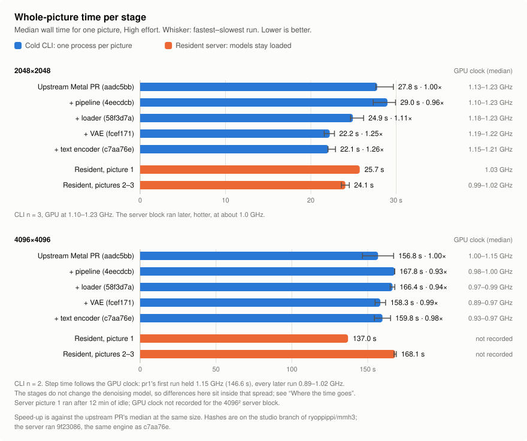
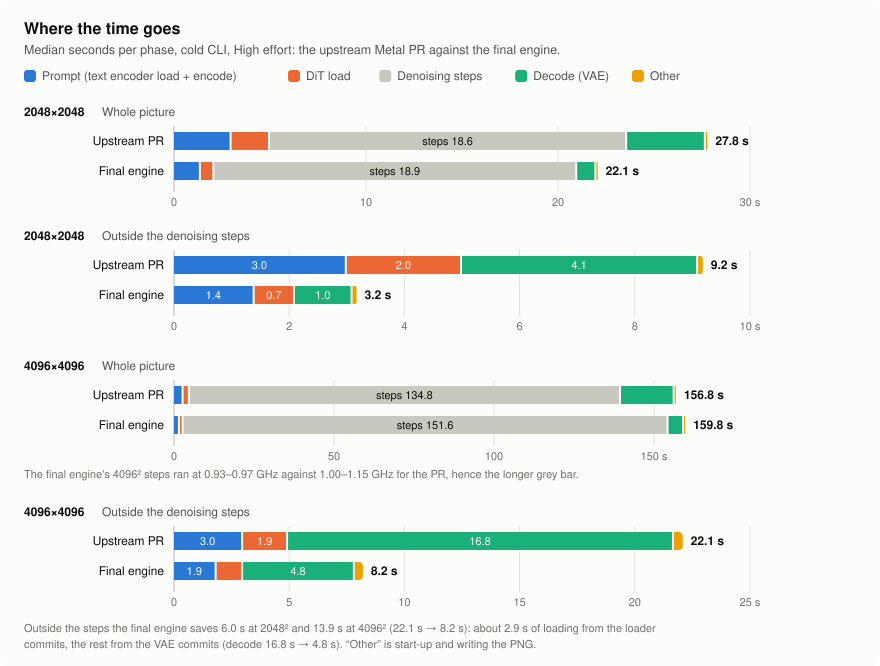
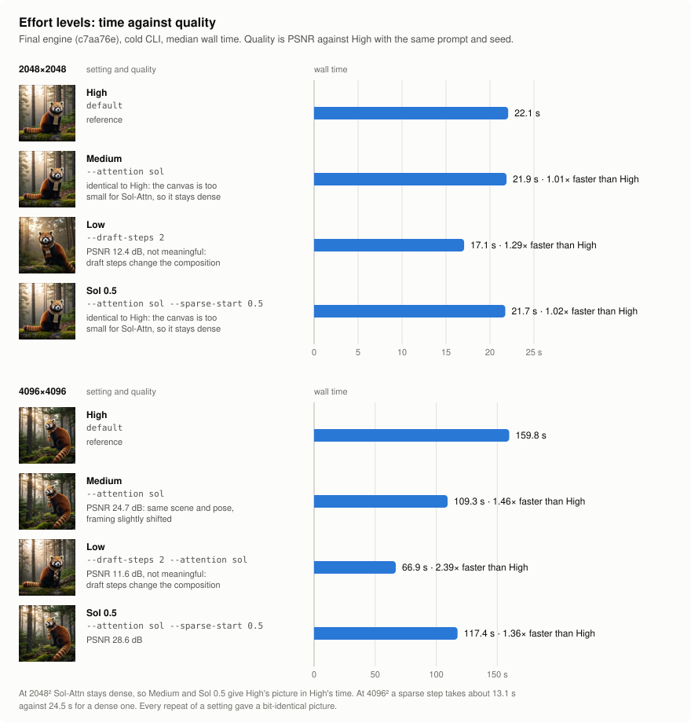
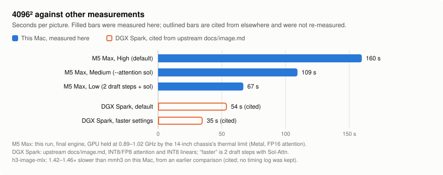

# Benchmarks

How long mmh3 takes to make one picture on a MacBook Pro, from the upstream Metal PR to the
engine the studio builds, and what the effort levels trade for time.

At 2048² the final engine is **1.26× faster** than the upstream Metal PR (22.1 s against 27.8 s).
At 4096² the GPU's thermal limit sets the whole-picture time, so the two medians are within noise.
Outside the denoising steps, where these changes apply, the final engine saves **13.9 s per 4096²
picture (22.1 s → 8.2 s)**. At equal GPU clocks that is about 9 % of the whole picture.

Measured on 2026-11-12. The conditions are listed [below](#conditions); read them before
comparing these numbers with any others.

## Whole-picture time per stage

Each stage adds commits from the `studio` branch of
[ryoppippi/mmh3](https://github.com/ryoppippi/mmh3/tree/studio) on top of the previous one:

| Stage | Commit | What it adds |
| --- | --- | --- |
| Upstream Metal PR | `aadc5bb` | The baseline: [niw/mmh3#1](https://github.com/niw/mmh3/pull/1) at the commit the `studio` branch forks from. |
| + pipeline | `4eecdcb` | Encodes the prompt once, reads the VAE ahead, keeps the prompt, and gives the VAE its own slot. |
| + loader | `58f3d7a` | Threaded weight reads, and leaves the embedding table on disk. |
| + VAE | `fcef171` | Batched tiles and FP16 VAE products. |
| + text encoder | `c7aa76e` | Fused text encoder projections. This is the final engine. |

Cold CLI: one process per picture, page cache warm. Median wall time in seconds, with min–max:

| Stage | 2048² (n = 3) | vs PR | 4096² (n = 2) | vs PR |
| --- | --- | --- | --- | --- |
| Upstream Metal PR | 27.8 (27.6–29.7) | 1.00× | 156.8 (146.6–167.1) | 1.00× |
| + pipeline | 29.0 (27.3–29.9) | 0.96× | 167.8 (167.7–167.9) | 0.93× |
| + loader | 24.9 (24.7–26.2) | 1.11× | 166.4 (164.8–167.9) | 0.94× |
| + VAE | 22.2 (21.6–22.8) | 1.25× | 158.3 (154.9–161.8) | 0.99× |
| + text encoder (final) | 22.1 (22.0–22.9) | 1.26× | 159.8 (154.4–165.1) | 0.98× |

These commits do not change the denoising model, and at 4096² the step time follows the GPU clock.
The PR's first 4096² run went first in the block, at 1.15 GHz, and took 146.6 s. Its second run, held
at about 1.0 GHz like every other 4096² run, took 167.1 s. The 4096² ratios above therefore measure
heat, not code; the next chart separates the two.

Resident server: `mmh3 server` built from studio `9f23086`, which is `c7aa76e` plus the
cancellation, preview, timing and server commits; it is the first build whose API reports timings,
and its pictures are bit-identical to `c7aa76e`'s. Three pictures in a row, in seconds:

| Size | Picture 1 | Picture 2 | Picture 3 |
| --- | --- | --- | --- |
| 2048² | 25.7 (loads models, 2.1 s load and encode) | 23.6 (prompt and DiT kept) | 24.5 |
| 4096² | 137.0 (loads models, 3.7 s load and encode) | 167.3 | 168.9 |

The server saves the 2–4 s of load and encode on every picture after the first. Its wall times are
no faster than the CLI's because heat decided them. The 2048² server ran straight after the 4096²
block, at about 1.0 GHz. The first 4096² picture came after about 11 minutes of idle.

## Where the time goes

Median seconds per phase, cold CLI, High effort. "Prompt" is the text encoder's load and encode,
which the log reports as one figure. "Other" is the rest of the wall time: process start-up and
writing the PNG. Each column is its own median, so a row need not add up to its wall time.

| Size | Engine | Prompt | DiT load | Steps | Decode | Other | Outside steps | Wall |
| --- | --- | --- | --- | --- | --- | --- | --- | --- |
| 2048² | Upstream PR | 3.0 | 2.0 | 18.6 | 4.1 | 0.1 | 9.2 | 27.8 |
| 2048² | Final | 1.4 | 0.7 | 18.9 | 1.0 | 0.1 | 3.2 | 22.1 |
| 4096² | Upstream PR | 3.0 | 2.0 | 134.8 | 16.8 | 0.4 | 22.1 | 156.8 |
| 4096² | Final | 1.9 | 1.2 | 151.6 | 4.9 | 0.4 | 8.2 | 159.8 |

- The loader commits cut loading from 5.0 s to 2.1 s. One final 4096² run took 3.9 s, hence the
  median of 3.0 s.
- The VAE commits cut decode from 4.1 s to 1.0 s at 2048² and from 16.8 s to 4.9 s at 4096².
- The step totals differ only with the GPU clock. At 4096² the PR's steps ran at 1.00–1.15 GHz,
  the final engine's at 0.93–0.97 GHz.

## Effort levels

The final engine at the studio's effort levels. Quality is RGB PSNR against High with the same
prompt and seed:

| Level | Options | 2048² | PSNR | 4096² | PSNR |
| --- | --- | --- | --- | --- | --- |
| High | default | 22.1 s | reference | 159.8 s | reference |
| Medium | `--attention sol` | 21.9 s | identical | 109.3 s | 24.7 dB |
| Low | `--draft-steps 2`, plus `--attention sol` at 4096² | 17.1 s | 12.4 dB, not meaningful | 66.9 s | 11.6 dB, not meaningful |
| Sol 0.5 | `--attention sol --sparse-start 0.5` | 21.7 s | identical | 117.4 s | 28.6 dB |

- At 2048² the canvas is too small for Sol-Attn, which stays dense. Medium and Sol 0.5 give High's
  picture in High's time.
- At 4096² a sparse step takes about 13.1 s against 24.5 s for a dense one.
- Low's draft steps change the composition (a frontal panda instead of a profile), so its PSNR says
  nothing about quality. Compare the pictures instead.
- Every repeat of a setting gave a bit-identical picture.

The pictures, downscaled to 768 px:

| Level | 2048² | 4096² |
| --- | --- | --- |
| High |  |  |
| Medium |  |  |
| Low |  |  |
| Sol 0.5 |  |  |

Prompt: "A red panda in a knitted scarf sits on a mossy log in a misty pine forest at dawn, soft
golden light filtering through the trees, photorealistic, detailed fur", seed 7.

## Against other measurements

Only the M5 Max rows were measured here. The rest are cited and were not re-measured:

| What | 4096² | Source |
| --- | --- | --- |
| M5 Max, final engine, High / Medium / Low | 160 s / 109 s / 67 s | this run |
| DGX Spark, 6 steps (INT8/FP8 attention, INT8 linears) | 54 s | upstream [`docs/image.md`](https://github.com/niw/mmh3/blob/master/docs/image.md), cited |
| DGX Spark, 2 draft steps with Sol-Attn (INT8/FP8 attention, INT8 linears) | 35 s | upstream [`docs/image.md`](https://github.com/niw/mmh3/blob/master/docs/image.md), cited |
| h3-image-mlx on this Mac | 1.42–1.46× slower than mmh3 | an earlier comparison on this Mac, cited; no timing log was kept |

The Mac runs FP16 attention on Metal with its GPU held at about 0.9–1.0 GHz by the thermal limit,
so the gap to the DGX Spark is not a like-for-like comparison of the code. Upstream's `docs/image.md`
lists further DGX Spark settings down to 24 s, and its own 14-inch M5 Max figures.

## Conditions

- **Machine:** 14-inch MacBook Pro, Apple M5 Max, 128 GB, macOS 27 (Darwin 27.2.0).
- **Power:** on AC with the 100 W adapter throughout, battery at 79–80 %.
- **Power mode:** `powermode 2` (High Power) in every snapshot. The fans stayed near their maximum,
  even at idle before the first run.
- **GPU clocks:** from macmon 0.10.0, which runs without sudo. Medians over each run's samples
  with the GPU more than 50 % busy:
  - 2048² CLI: 1.10–1.23 GHz at 29–37 W.
  - 4096² CLI: 1.15 GHz at 36 W for the first run. Every later run was held at 0.89–1.02 GHz and
    22–28 W by the power and cooling of the 14-inch case, whatever the adapter; upstream's
    `docs/image.md` describes the same limit on this machine.
  - 2048² server: 0.99–1.03 GHz at 23–26 W.
  - 4096² server: not recorded. The macmon binary was garbage-collected from the Nix store partway
    through.
- **Background load:** `mediaanalysisd` (a macOS system process that analyses Photos) was at about
  200 % CPU in the two snapshots taken at 10:10, just before the 4096² server block, and absent
  from those at 09:58 and 10:18, so it probably ran during some of the 4096² server pictures. It
  was left running. macmon took about 20 % of one core.

## Method

- Each stage was built in its own worktree with
  `cargo build --release --features metal,server --bin mmh3` in the mmh3 dev shell.
- Models: INT8 DiT, INT8 text encoder, FP16 VAE. No latent upscaler was present, so draft steps
  were enlarged bilinearly.
- Cold CLI: one process per picture, with one untimed warm-up run first. Every GPU process ran
  under a lock, never two at once, with a 10 s pause between runs. The 8 configurations ran
  round-robin, starting from a different one each round: 3 rounds at 2048², then 2 at 4096².
  Wall time is `/usr/bin/time -p` real. The phase times come from mmh3's own log.
- Resident: a fresh `mmh3 server` per size, three `POST /v1/images` in a row, with the times taken
  from the generation's `timings`.
